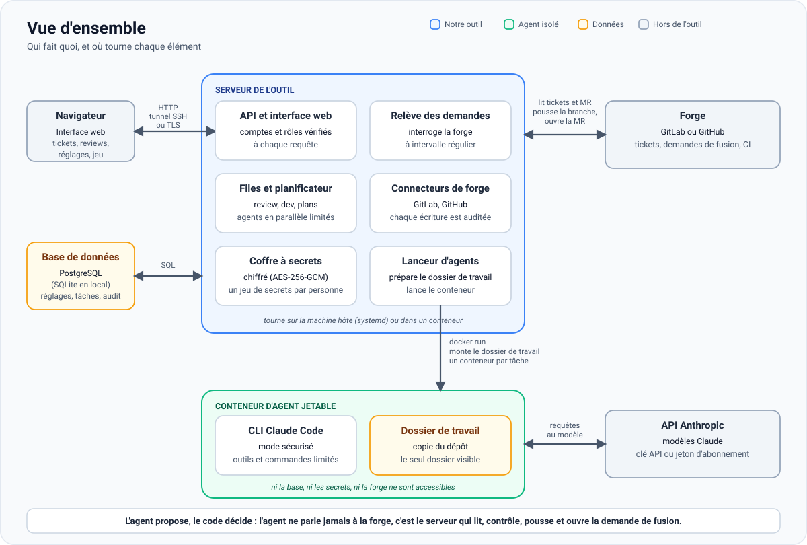
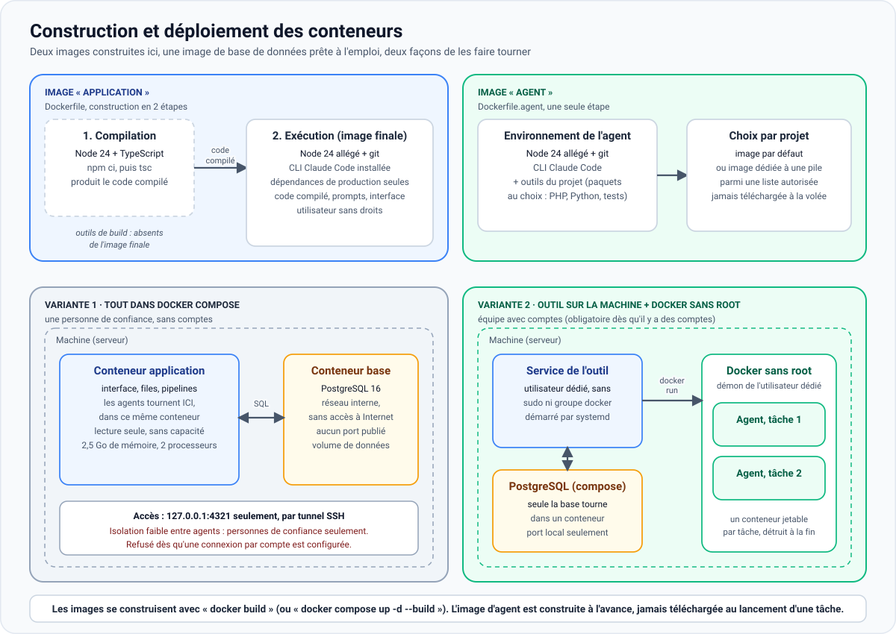
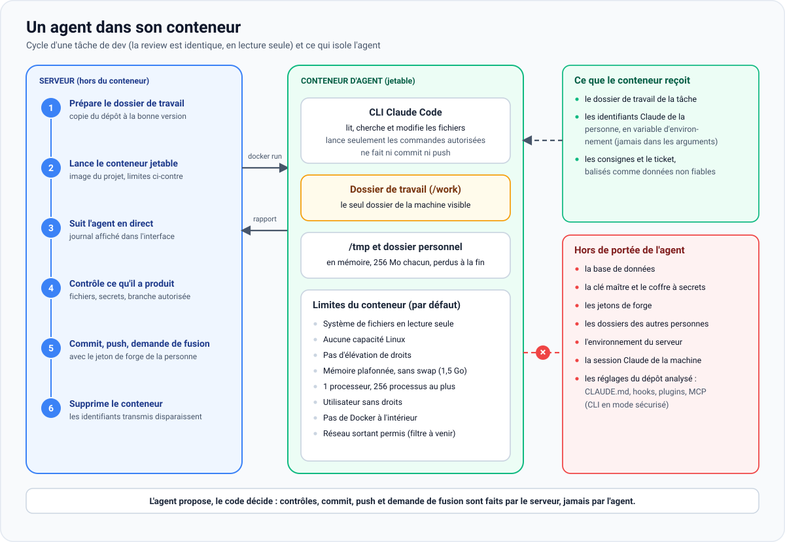

# Architecture

Ce document décrit l'outil, pas le planning : pour le planning, voir `docs/roadmap.md`. Le déploiement pas à pas est dans `docs/deploiement.md`.

## Objectif

Une plateforme qui pilote Claude Code sur le travail quotidien d'une forge (GitLab ou GitHub), au nom de chaque personne :
1. **Tickets** : voir mes tickets assignés, rangés par statut du workflow.
2. **Agent dev** : déléguer un ticket à un agent. Il code dans un dossier de travail isolé, puis l'outil pousse la branche et ouvre une MR Draft que je contrôle avant de la passer en Ready.
3. **Reviews** : faire la première passe de review des MR où je suis reviewer, et ne me remonter que ce qui mérite mon analyse.
4. **Scribe et orchestrateur de plans** : un agent sans aucun outil rédige des brouillons de tickets ou de projets, ou cadre un plan par chat. Rien n'est créé chez la forge avant la validation de la personne, puis les tickets d'un plan peuvent être exécutés l'un après l'autre.
5. **La forge** : une couche de jeu optionnelle, déduite de l'activité réelle, que l'on peut éteindre.
6. Plus tard : le support Planio (diagnostic, brouillon de réponse, brouillon d'issue).

L'outil tourne de deux façons : **sur un poste** (une seule personne, base SQLite, tunnel ou localhost) ou **sur un serveur** (PostgreSQL, comptes, équipes, quotas, agents en conteneurs). Le code est le même ; ce qui change est la configuration (`docs/deploiement.md`).

## Les schémas

Les schémas sont des fichiers SVG (`docs/schemas/`), lisibles dans GitHub et dans l'aperçu Markdown de l'éditeur. Les noms y sont **génériques** (serveur, forge, conteneur d'agent...) ; la correspondance avec le code est dans le tableau qui suit.

### 1. Qui fait quoi, et où tourne chaque élément

Trois choses à retenir :
- **Le serveur est le seul à parler à la forge.** Il lit les tickets et les MR, puis pousse la branche et ouvre la MR avec le jeton de la personne. L'agent n'y a jamais accès.
- **L'agent tourne dans un conteneur jetable**, créé pour une tâche et supprimé ensuite. Il ne voit que son dossier de travail et ne parle qu'à l'API du modèle.
- **Le code décide, pas le modèle.** Le modèle propose (review, code, rapport) ; le serveur contrôle puis agit selon des règles lisibles et testées.

### 2. Construction et déploiement des conteneurs

### 3. Un agent dans son conteneur

### Correspondance entre les noms des schémas et le code

| Dans les schémas | Dans le code |
|---|---|
| Serveur de l'outil | `src/index.ts` (point d'entrée), `src/server/app.ts` (API Fastify) |
| API et interface web | `src/server/app.ts`, `public/` |
| Comptes et rôles | `src/auth/` (table des droits : `src/auth/permissions.ts`), `src/team/` |
| Relève des demandes | `src/triggers/reviewPoller.ts` |
| Files et planificateur | `src/queue.ts`, `src/tenants/` (une exécution par personne), `src/orchestrator/scheduler.ts` |
| Connecteurs de forge | `src/connectors/` (`gitlab.ts`, `github.ts`, `audited.ts`) |
| Coffre à secrets | `src/secrets/` |
| Pipelines | `src/review/`, `src/dev/` |
| Lanceur d'agents | `src/agent/` (`cliRunner.ts`, `dockerRunner.ts`) |
| Conteneur d'agent | image `Dockerfile.agent`, arguments dans `buildDockerArgs` |
| Image « application » | `Dockerfile`, `docker-compose.yml` |
| Base de données | `src/db/` |

## Où tourne chaque élément

| Élément | Où | Détail |
|---|---|---|
| Interface web | Navigateur | Pages servies par le serveur (`public/`), sans étape de build. Le navigateur ne détient aucun secret : il envoie des requêtes à l'API, avec un en-tête anti-CSRF obligatoire pour toute action |
| Serveur de l'outil | Machine hôte (systemd) ou conteneur | Écoute sur `127.0.0.1:4321` seulement. Accès par tunnel SSH, ou par un proxy TLS avec connexion par compte |
| Base de données | PostgreSQL (serveur) ou SQLite (poste) | Mêmes tables dans les deux cas. En serveur, PostgreSQL est un conteneur sans port public ou publié sur `127.0.0.1` |
| Agents de dev et de review | Conteneur jetable, un par tâche | `AGENT_RUNTIME=docker` (défaut). Le serveur lance `docker run` et supprime le conteneur à la fin |
| Terminal Claude du navigateur | Conteneur jetable du même type (mode conteneur) | Réservé au propriétaire, c'est la CLI seule, jamais un shell |
| Scribe, orchestrateur, test de connexion | Même exécuteur, **sans aucun outil** | Dossier temporaire vide, rien ne peut être lu ni écrit |

### Les deux variantes de déploiement

- **Variante 1, tout dans Docker Compose** (`docker-compose.yml`) : l'application et PostgreSQL sont deux conteneurs. L'application n'a **pas** accès à Docker, donc elle ne peut pas lancer de conteneurs d'agents : les agents tournent dans son propre conteneur (`AGENT_RUNTIME=host`). C'est acceptable pour une personne de confiance, et c'est **refusé au démarrage dès qu'une connexion par compte est configurée**.
- **Variante 2, l'outil sur la machine avec Docker sans root** (`deploy/review-agent.service`, `docker-compose.hote.yml`) : seule la base est dans Compose. L'outil tourne sous un utilisateur dédié (sans `sudo`, hors du groupe `docker`) et lance les agents par **son propre démon Docker sans root**. Une évasion d'un conteneur, ou une compromission de l'outil, ne donne que les droits de cet utilisateur. C'est la variante à utiliser dès qu'il y a des comptes.

Pourquoi ne pas monter le socket Docker dans le conteneur de l'application (une troisième voie) : le conteneur de l'application deviendrait équivalent à root sur la machine, et un proxy de socket n'y change rien, car il ne peut pas filtrer les dossiers montés. Voie écartée.

## Construction des images

| Image | Fichier | Contenu | Construction |
|---|---|---|---|
| Application | `Dockerfile` | Node 24 allégé, git, CLI Claude Code, dépendances de production, code compilé, prompts, interface. Utilisateur sans droits (uid 10001), `HEALTHCHECK`, dossier personnel dans le volume de données | **Deux étapes** : compilation TypeScript (outils de build jetés ensuite), puis image d'exécution. `docker compose up -d --build` |
| Agent | `Dockerfile.agent` | Node 24 allégé, git, CLI Claude Code, plus les outils du projet (paquets Debian passés en `AGENT_PACKAGES`). Pas d'utilisateur ni de dossier personnel : l'outil les impose au lancement | Une étape. `docker build -f Dockerfile.agent -t review-agent-sandbox:local .` |
| Base | `postgres:16-alpine` | Image officielle, non construite ici | Téléchargée par Compose |

- **Versions figées** : `CLAUDE_CODE_VERSION` (argument de build) fige la version de la CLI pour une image reproductible.
- **Une image par pile technique** : les projets n'ont pas tous les mêmes outils (PHP 7, PHP 8, Node...). On construit une image par pile, on liste leurs noms dans `AGENT_IMAGES` (le `.env`), et chaque projet choisit la sienne dans les Paramètres. Seules les images de cette liste sont permises : un réglage de projet ne peut pas lancer n'importe quelle image présente sur la machine. L'image par défaut est `AGENT_IMAGE`.
- **Jamais de téléchargement au lancement** : `docker run --pull never`. L'image doit exister, sinon la tâche échoue avec la raison.
- **Dans un conteneur il n'y a pas de Docker** : les « commandes autorisées » d'un projet appellent directement les outils de l'image (`vendor/bin/phpunit`).

## Isolation d'un agent

Chaque tâche a **son** conteneur, jamais un conteneur par projet : un conteneur qui resterait en vie garderait ce qu'un agent manipulé y laisse pour les tâches suivantes (d'autres personnes comprises). Ce qui est par projet, c'est l'**image** ; le conteneur est recréé à chaque tâche.

**Autour du conteneur** (`buildDockerArgs`, `src/agent/dockerRunner.ts`) :
- système de fichiers en **lecture seule** ; `/tmp` et le dossier personnel de l'agent sont en mémoire (256 Mo chacun) et perdus à la fin ;
- **aucune capacité Linux** (`--cap-drop ALL`), pas d'élévation de droits (`no-new-privileges`) ;
- mémoire plafonnée **sans swap** (`AGENT_MEMORY`, 1536m par défaut), processeurs (`AGENT_CPUS`, 1) et processus (`AGENT_PIDS`, 256) plafonnés ;
- **un seul dossier monté**, celui de la tâche, sur `/work` : ni la base, ni la clé maître, ni les jetons de forge, ni les dossiers des autres personnes, ni l'environnement de l'outil ;
- utilisateur sans droits ; avec Docker sans root, l'utilisateur de l'outil est « root DANS le conteneur » (`AGENT_CONTAINER_USER=auto`), seule correspondance qui permet d'écrire dans le dossier de travail, sans danger car ce root n'a aucun droit sur la machine ;
- le conteneur est nommé, et supprimé même après une annulation ou un délai dépassé.

**Ce que le conteneur reçoit** : le dossier de travail et les identifiants Claude de la personne, **un seul des deux** : sa clé API, ou son jeton d'abonnement (`claude setup-token`, valable un an). Ils passent par l'environnement du client `docker` (`docker run -e NOM` sans valeur), jamais dans les arguments, que tout le monde peut lire avec `ps`. Le dossier personnel de la machine (`~/.claude`, où vit une session `/login`) n'est **jamais monté**. Sans identifiants, l'outil refuse de lancer l'agent plutôt que de retomber sur la machine.

**Dans le conteneur, la CLI est en mode sécurisé** (`buildCliArgs`, `src/agent/cliRunner.ts`, hors de portée des appelants) : `--safe-mode` ignore le `CLAUDE.md`, les hooks, les plugins, les skills et les MCP du dépôt analysé, `--strict-mcp-config` sans configuration (aucun serveur MCP), mode `dontAsk` (ce qui n'est pas explicitement autorisé est refusé, sans question).

**Ce qui n'est pas encore fait** : le réseau sortant du conteneur n'est pas filtré (accès à Internet par défaut ; les outils `WebFetch`, `WebSearch`, `curl`, `wget` et `ssh` sont interdits à l'agent, mais cela relève des permissions de la CLI, pas du réseau). Une liste blanche d'adresses est prévue (D7 de `docs/roadmap-plateforme.md`). La clé ou le jeton est lisible par l'agent de la personne (il en a besoin) : un agent manipulé pourrait l'envoyer ailleurs, d'où l'intérêt d'une clé avec un budget limité.

Le bouton **« Tester les conteneurs »** (Paramètres) lance un conteneur d'essai aux options d'une vraie tâche et contrôle la connexion à Claude, Docker, l'image, l'écriture, l'isolation, les plafonds réellement appliqués et la CLI. **« Vérifier la connexion »** envoie une requête minimale sans outil et dit si Anthropic accepte ou refuse le jeton (`src/agent/connectionCheck.ts`).

## Configuration : .env, tableau de bord ou coffre

| Où | Quoi | Pourquoi |
|---|---|---|
| `.env` | Base (`DATABASE_URL`), clé maître des secrets, connexions par compte (`AUTH_*`, email), adresse publique, agents (`AGENT_*`), port, dossier de données, cadence de relève, nombre d'agents simultanés | Secrets et réglages propres à la machine |
| Tableau de bord (table `settings`) | Mode d'action, déclenchement des reviews, connexion à Claude, modèles et effort, budgets et quotas, règles de décision, labels du workflow, conventions de nommage | Réglables sans toucher au code ni redémarrer |
| Tableau de bord (table `projects`) | Par projet : agent autorisé, branche de départ, branche cible, commandes autorisées, image d'agent, consignes | Chaque projet a ses branches (`global`, intermédiaire, `master`...) |
| Coffre à secrets (table `secrets`) | Jetons de forge, clé API Anthropic, jeton d'abonnement Claude, saisis dans le tableau de bord | Chiffrés (AES-256-GCM), un jeu par personne et par espace |

Les réglages sont validés par zod (`src/settings/schema.ts`) côté serveur. Les modèles et efforts acceptés sont des listes blanches (`ALLOWED_MODELS`, `ALLOWED_EFFORTS`) : un identifiant hors liste est refusé même si on contourne l'interface. Le défaut reste Sonnet 5.5, effort `high`. Un réglage ajouté dans une version ultérieure prend sa valeur par défaut sans casser la base existante (`mergeWithDefaults`).

## Comptes, espaces et secrets

- **Connexion** : par compte de forge (OAuth avec PKCE) ou par email et mot de passe (empreinte scrypt avec sel), avec mot de passe oublié et invitations par email. **Sans connexion configurée, l'outil est mono-utilisateur** : tout se passe dans l'espace de la personne locale, qui est propriétaire.
- **Espaces** : chaque personne a un espace ; un espace peut devenir une équipe (membres, rôles, invitations à usage unique, limites par membre). Les dépôts, files, pollers, connexions aux forges et secrets sont **par espace**, et aucune requête ne sort de son espace.
- **Droits** : trois niveaux, `read`, `act` et `admin`, dans UNE table `MÉTHODE /route` vers un niveau (`src/auth/permissions.ts`), contrôlée dans un seul crochet du serveur. Une route non classée est refusée à tous, et un test vérifie la table dans les deux sens.
- **Quotas** : budget du mois (mode clé API) et nombre d'agents par jour, par personne, contrôlés au lancement. Les agents simultanés sont limités ensemble (`MAX_CONCURRENT_AGENTS`).
- **Secrets** : chiffrés avec une clé maître **hors de la base** (`SECRETS_MASTER_KEY` en mode serveur), avec rotation possible. Le journal masque toute valeur déclarée secrète, même dans un message d'erreur.

## Agent dev : déroulé d'une tâche

`src/dev/pipeline.ts`, déclenché par le bouton « Traiter avec l'agent » de l'onglet Tickets :

1. **Vérifications** : le projet doit être configuré et activé, et aucun autre agent ne doit travailler sur ce ticket. Le quota de la personne est contrôlé.
2. **Branche** : son nom vient du template (`feature/{iid}-{slug}` par défaut).
   - Elle passe par `assertBranchAllowed` (`src/dev/guard.ts`), qui exige un nom valide contenant le numéro du ticket. Ce ne peut être ni une branche partagée, ni la base, ni la cible, ni une branche protégée de la forge.
   - Elle ne doit pas déjà exister chez la forge.
   - Elle est créée depuis la branche de départ à jour, dans un worktree dédié (`data/repos/dev/`).
3. **Label** (optionnel) : posé sur le ticket au démarrage (ex. `Statut::En cours`).
4. **Agent** (`src/dev/engine.ts`) : `claude -p` en `stream-json`, dans un conteneur jetable (voir « Isolation d'un agent »). Le journal du tableau de bord est alimenté en direct.
   - Il reçoit le ticket, sa discussion, le CLAUDE.md du dépôt et tes consignes éventuelles.
   - Il produit un rapport structuré : `done` ou `blocked`, résumé, message de commit, tests, points à vérifier, questions.
5. **Si `blocked`** (ticket trop ambigu) : rien n'est poussé, les questions s'affichent dans le tableau de bord.
6. **Contrôles avant push**, faits par le serveur :
   - si l'agent a committé lui-même malgré l'interdiction, ses commits sont repliés (`reset --soft`) dans le commit de l'outil ;
   - au moins un fichier doit être modifié ;
   - aucun fichier de secrets (`.env`, clés) ne doit l'être, sinon le push est refusé ;
   - contrôle des fichiers (`src/dev/fileGuard.ts`) : pas de chemin absolu, avec `..` ou dans `.git`, pas de lien symbolique sortant du dépôt, taille limitée, et encodage préservé (un fichier ISO-8859-1 réécrit en UTF-8, ou contenant U+FFFD, est refusé).
7. **Commit** au format configuré, avec l'identité de forge de l'utilisateur. Le sujet proposé par l'agent est nettoyé : une ligne, sans trailer `Co-Authored-By`.
8. **Push** : `git push origin HEAD:refs/heads/<branche>`, sans `--force`, après une seconde vérification de la branche.
9. **MR** : toujours en **Draft** (`ensureDraftTitle`, quel que soit le template), vers la branche cible du projet, assignée à l'utilisateur. La description reprend le template et le rapport de l'agent, et signale les fichiers sensibles modifiés (CI, Docker, dépendances).

Le passage en Ready se fait par la personne (selon le workflow de l'équipe, il peut faire passer le ticket en validation technique) : soit chez la forge, soit depuis l'outil avec la fusion de la pièce (voir ci-dessous).

10. **Relecture et fusion de la pièce** (`src/dev/merge.ts`, `src/dev/pieceRoutes.ts`) : depuis la forge (fenêtre « La pièce forgée ») ou la page de la tâche, la personne fait relire la MR par le Maître juré (l'agent de review, en lecture seule, qui ne publie rien sur sa propre MR), puis, si la review est OK sur le commit actuel et la CI sans rouge, la fusionne dans la branche cible du projet. `mergeReadiness` est une fonction pure rejouée par le serveur à chaque demande : MR ouverte, branche source = branche de la tâche, cible = cible du projet, review terminée sans point à analyser sur le commit de tête, CI ni rouge ni en cours (et lisible). La MR est sortie du brouillon puis fusionnée avec le `sha` relu (la forge refuse si la tête a bougé). Les deux écritures sont tracées au journal d'audit (`change_request_ready`, `change_request_merge`). **L'outil ne déploie rien** : la mise en ligne est celle du projet (CI/CD, hébergement) ou, pour l'outil lui-même, `git pull` puis `docker compose up -d --build`. **Corriger avec la relecture** (`POST /api/tasks/:id/fix-review`, ou `POST /api/tasks/:id/followup` avec `withReview: true`, c'est la case « Joindre la relecture » de la reprise) : si la relecture du commit actuel a des points, la personne relance l'agent dev sur la MR (reprise) ; les points sont lus en base, jamais fournis par le navigateur, et remis à l'agent comme contenu non fiable (`src/dev/reviewFeedback.ts`). Les deux routes partagent les mêmes refus (`reviewToFix` dans `app.ts` : MR fermée ou fusionnée, pas de relecture, relecture d'un ancien commit, relecture sans point). **Sans cette case, l'agent de reprise ne voit que les consignes et les commentaires PUBLIÉS sur la MR** : une relecture lancée depuis la page de la tâche ne publie rien, donc elle ne lui parvient que par cette case ou par « Corriger ». La page d'une review (`GET /api/reviews/:id`) donne `devTask` (la tâche dont la MR est vivante) pour renvoyer à la page qui propose relecture, correction et fusion.

Le worktree est **conservé** après la tâche, puis nettoyé d'un clic. **En mode machine** (`AGENT_RUNTIME=host`), on peut reprendre la conversation avec `claude --resume <session>` depuis son dossier (commande affichée dans le tableau de bord). **En mode conteneur** cette reprise n'existe pas, car la session ne survit pas à la tâche. Le dossier monté étant un `git worktree` dont le dépôt est ailleurs sur la machine, les commandes `git` de l'agent y échouent : il lit, cherche et modifie les fichiers, et c'est l'outil qui fait les commits et le push.

### Reprise d'une MR existante

Bouton « Reprendre avec des consignes » sur une tâche terminée liée à une MR. Une nouvelle tâche (`mode = followup`, `parent_id` = tâche d'origine) hérite de la branche et de la MR :

1. **Vérifications** : consignes obligatoires (sauf avec la relecture jointe), MR toujours ouverte et partant de la même branche, `assertBranchAllowed` comme au premier passage.
2. **Branche** : récupérée **telle qu'elle est chez la forge** (`checkoutExistingBranch`), commits poussés à la main compris. Refus si l'ancien worktree contient des modifications non committées ou des commits non poussés, pour ne jamais écraser du travail local.
3. **Agent** : reçoit tes consignes, le ticket, le rapport de la tâche d'origine, les commentaires de la MR (fichier, ligne, résolu ou non) et la commande pour voir tout le diff de la MR.
4. **Mêmes contrôles avant push** qu'au premier passage, puis **nouveau commit** poussé en fast-forward (jamais de `--force`) et commentaire sur la MR avec les consignes et le rapport. Statut `mr_updated`. Bloqué = rien n'est poussé.

Dans les commandes autorisées d'un projet, `{worktree}` est remplacé par le dossier de travail de l'agent en mode machine. En mode conteneur il ne sert pas : l'image contient les outils.

## Review : déroulé

1. **Détection** (`src/triggers/reviewPoller.ts`) : toutes les `POLL_INTERVAL_SEC` secondes, le poller liste les MR ouvertes, hors draft, où l'utilisateur est reviewer, et dont il n'est pas l'auteur. Le réglage « Déclenchement » choisit lesquelles sont analysées : toutes (`all`), celles des projets configurés (`configured`), ou aucune toute seule (`manual` : elles sont détectées et la personne lance la review). Chaque couple (MR, sha de tête) n'est traité qu'une fois : un nouveau push crée une nouvelle review.
2. **Contexte** (`src/review/context.ts`) : diffs filtrés (lockfiles, assets compilés, images, `.env`), tickets liés, commits et statuts CI. Les textes rédigés par des humains sont balisés `<contenu_externe>`.
3. **Checkout** (`src/review/workspace.ts`) : `refs/merge-requests/<iid>/head`, puis un worktree jetable au sha exact.
4. **Agent** (`src/review/engine.ts`) : `claude -p` en lecture seule dans un conteneur jetable, sortie contrainte par `--json-schema`.
5. **Décision** (`src/review/decision.ts`) : c'est le **code** qui décide, pas le modèle. Une review n'est `auto_ok` qu'avec des suggestions uniquement et aucun garde-fou déclenché.
6. **Action** selon le mode réglé dans le tableau de bord : `shadow` (rien), `comment`, ou `auto` (commentaire et approbation liée au sha). Les `needs_human` ne partent jamais seules.

Si une review échoue (jeton refusé, délai dépassé), la page garde le résultat de la review précédente mais le signale comme **« run précédent »**, pour qu'un ancien verdict ne passe pas pour celui du run qui a échoué.

## Modules

| Fichier | Rôle |
|---|---|
| `src/index.ts` | Point d'entrée : config, base, coffre, comptes, gestionnaire d'espaces (files, poller et planificateur par personne), terminal, serveur |
| `src/config.ts` | Lecture du `.env` (secrets et machine uniquement) et refus des combinaisons dangereuses (ex. `AGENT_RUNTIME=host` avec des comptes) |
| `src/server/app.ts` | API JSON et service du tableau de bord |
| `src/queue.ts`, `src/tenants/` | Files d'attente. Exécution par personne et par espace : connexions aux forges de son coffre, dépôts liés à son espace, files et pollers (`manager.ts`), limite commune d'agents simultanés (`limiter.ts`). Le serveur redirige chaque requête vers l'exécution de la personne connectée |
| `src/agent/` | Exécuteur d'agent : interface `AgentRunner`, `CliRunner` (CLI Claude Code), événements du journal. Les protections d'isolation de la CLI (`--safe-mode`, aucun MCP, `dontAsk`) y sont écrites, hors de portée des appelants |
| `src/agent/dockerRunner.ts` | Lancement dans un conteneur jetable : arguments de `docker run`, environnement du client docker, utilisateur du conteneur, suppression. L'agent et le terminal n'y reçoivent que les identifiants Claude de la personne |
| `src/agent/imageName.ts` | Noms d'images d'agents et liste autorisée (`AGENT_IMAGE`, `AGENT_IMAGES`) : l'image par défaut ou celle choisie par un projet |
| `src/agent/dockerDiagnostic.ts` | Diagnostic des conteneurs (bouton « Tester les conteneurs ») : conteneur d'essai aux options d'une vraie tâche, sept contrôles |
| `src/agent/connectionCheck.ts` | Test réel de la connexion à Claude (bouton « Vérifier la connexion », et après chaque enregistrement d'un jeton) : requête minimale sans outil dans un dossier temporaire, constat `ok`, `refused`, `missing` ou `error`, mémoire courte par personne et par jeton pour ne pas dépenser le quota |
| `src/claude/process.ts` | Lancement de la CLI : stdin, streaming ligne par ligne, délai maximum, annulation, environnement sans clé API |
| `src/claude/status.ts` | Sonde de l'état de connexion de la CLI, mise en mémoire 30 s : pastille « connecté » des Paramètres (présence du jeton, pas contrôle auprès d'Anthropic) et quête du jeu |
| `src/terminal/` | Terminal Claude du navigateur, pour connecter l'abonnement sans SSH : `session.ts` (une session par personne, sortie gardée, expiration), `launch.ts` (la CLI `claude` seule dans un pseudo-terminal fourni par l'outil `script`, dans un conteneur du même type que les agents en mode conteneur, directement sur la machine en mode machine, jamais un shell), `routes.ts` (flux de sortie en Server-Sent Events, saisie par requêtes, réservé au propriétaire, refusé derrière un proxy sans connexion par compte). Côté navigateur : xterm.js, servi par l'outil (`public/vendor/xterm/`, version figée). Une connexion `/login` faite dedans n'est pas conservée |
| `src/review/*` | Review : contexte, worktree git (partagé avec l'agent dev), moteur, décision, mise en forme, orchestration |
| `src/dev/*` | Agent dev : garde-fous de branche et de fichiers, templates, contexte, moteur, orchestration, relecture et fusion de la pièce |
| `src/triggers/reviewPoller.ts` | Relève périodique des MR à relire |
| `src/connectors/` | Interface `ForgeConnector` et vocabulaire neutre (ticket, demande de fusion, commentaire...). `gitlab.ts` et `github.ts` : un connecteur par forge, les seuls à connaître l'API et les types de leur forge. `registry.ts` : registre des forges configurées (connecteur, copies locales de dépôts, identité de l'utilisateur), retrouvées par la colonne « source ». `audited.ts` : chaque écriture est inscrite au journal d'audit au nom de la personne. Les pipelines, le poller, le serveur et la CLI n'utilisent que l'interface |
| `src/gitlab/client.ts`, `src/github/` | Clients API (fetch natif, pagination), utilisés par leur connecteur uniquement |
| `src/planio/` | Client Planio, pas encore branché (support client) |
| `src/auth/` | Connexion et accès : OAuth avec PKCE (`oauth.ts`), sessions (`sessions.ts`), règles d'accès (`login.ts`), mots de passe (`password.ts`, `passwordLogin.ts`, `passwordRoutes.ts`), pages publiques (`pages.ts`), limiteur de tentatives par adresse IP (`rateLimit.ts`), droits par rôle (`permissions.ts`). Dormant sans connexion configurée |
| `src/team/` | Équipe d'un espace (administrateurs) : membres, rôles, retrait, invitations, limites par membre, transformation d'un espace personnel en équipe. L'interface est `public/team.js` |
| `src/mail/` | Envoi d'emails : client Resend sans bibliothèque (clé en en-tête, délai maximal, erreurs sans la clé) et modèles (texte et HTML, noms échappés) |
| `src/secrets/` | Coffre à secrets : chiffrement AES-256-GCM (`crypto.ts`), clé maître hors base (`masterKey.ts`), table `secrets` par espace et utilisateur (`store.ts`), jetons et clés saisis dans le tableau de bord (`vault.ts`). `src/logger.ts` masque dans les journaux toute valeur déclarée secrète |
| `src/budget.ts` | Budget de l'espace et limites par personne (`assertQuotaAvailable`) : budget du mois (mode clé API) et agents par jour, contrôlés au lancement par l'API et au démarrage de la file |
| `src/settings/` | Schéma, valeurs par défaut et stockage des réglages et projets. Le magasin garde aussi des sections de données propres à une fonctionnalité (`getSection`, `saveSection`, sans migration : la table `settings` est clé-valeur), dont le noyau ne connaît pas le contenu : c'est ainsi que la forge range ses réglages |
| `src/db/` | Accès à la base indépendant du moteur : interface `Db` asynchrone, adaptateurs SQLite (`node:sqlite`, poste) et PostgreSQL (`pg`, serveur), migrations communes ; dépôts `reviews`, `devTasks`, `costs`, `plans` liés à un espace (aucune requête ne sort de son espace), `accounts` (utilisateurs, espaces, appartenances), `credentials`, `emailTokens`, `invitations`, `audit` |
| `src/scribe/` | Le Scribe : un agent sans aucun outil rédige un brouillon de ticket ou de projet (`engine.ts`, `prompt.ts`, `schema.ts`), `clean.ts` valide ce qui peut partir chez la forge, `errors.ts` traduit un refus en droit à ajouter au jeton, `limiter.ts` plafonne par heure, `routes.ts` expose `/api/scribe/*` et `/api/forge/{tickets,namespaces}`. L'écriture passe par le connecteur (donc par l'audit) et seulement après la validation de la personne. Page du tableau de bord : `#tickets/new` (`public/scribe.js`) |
| `src/orchestrator/` | L'orchestrateur de plans : chat de cadrage (`chat.ts`, `prompt.ts`, `schema.ts` ; même agent sans outil que le Scribe), liste de tickets relue puis validée par la personne, création des tickets chez la forge à la validation seulement, exécution planifiée un ticket après l'autre par l'agent dev (`scheduler.ts`, un passage toutes les 15 s par personne, démarré par `TenantManager`), `schedule.ts` (dates), `routes.ts` (`/api/plans/*`). Un ticket en échec arrête le plan ; avec l'option « attendre la fusion », le ticket suivant n'est lancé qu'une fois la MR du précédent fusionnée (`mergeGate`). Données : `src/db/plans.ts`. Page : `#tickets/plans` (`public/plans.js`) |
| `src/notify/` | Notifications : l'adresse d'un webhook Discord ou Slack (secret chiffré du coffre de la personne, `webhook.ts` la contrôle et fixe le format du message : aucune mention permise) et `notifier.ts` qui envoie (plafond de 20 messages par heure, une erreur ne remonte jamais à ce qui déclenche l'envoi). Déclenchée par l'orchestrateur (plan en échec, terminé, MR à fusionner) et le pipeline de review (review à analyser). `routes.ts` : `/api/notify/*`, section « Notifications » des Paramètres |
| `src/dev/codeView.ts` | Code d'une MR pour le tableau de bord : diffs lus chez la forge, bornés (80 fichiers, 60 000 caractères par fichier, 400 000 au total) et résumés (ajouts, suppressions). Route `GET /api/tasks/:id/diff` (`pieceRoutes.ts`), affichage par `public/diff.js` (page d'une tâche et page des plans) |
| `src/attachments/` | Pièces jointes (captures, maquettes, données) pour l'agent dev et les tickets du Scribe : `rules.ts` (types, tailles, contenu réel, noms), `store.ts` (fichiers par espace sous `DATA_DIR/attachments`, sans table), `routes.ts`. Posées dans `.ra-attachments/` du dossier de travail le temps de l'agent, supprimées ensuite, jamais committées |
| `src/game/` | La forge, couche de jeu **isolée du noyau** (rien hors de `src/game/` et `src/rooms/` ne l'importe, sauf l'appel `registerGame` de `app.ts`) et éteignable. `routes.ts` : toutes ses routes, dans un plugin dont le garde répond 404 quand le jeu est éteint (seul `/api/game`, le drapeau, reste joignable). `prefs.ts` : le drapeau et le type d'arme par projet. Couche déduite de l'activité réelle : `hero.ts` (XP, niveaux, quêtes, hauts faits), `workers.ts` (forgerons de l'atelier), `armory.ts` (projets = armes, tâches terminées = pièces forgées, notes et raretés), `loot.ts` (butin déterministe : le tirage ne dépend que de l'identifiant de l'événement), `progress.ts` (série de jours, missions, maîtrises, prestige) |
| `src/rooms/` | Salles du monde de la forge, décrites par des fichiers de données (`public/rooms/*.json`) : `catalog.ts` (objets, thèmes, limites), `schema.ts`, `registry.ts`, `routes.ts` (`GET /api/rooms`). Seules les salles livrées et l'arène existent, les salles créées par les utilisateurs ont été retirées. Format : `docs/salles.md` |
| `public/` | Tableau de bord sans étape de build : `index.html` (pages et fenêtres de Paramètres), `scribe.js`, `plans.js`, `team.js`, `vendor/xterm/` |
| `public/forge/` | Monde 2D de la page « La forge », chargé à la demande : pixel art dessiné par le code (`sprites.js`), sons synthétisés désactivés par défaut (`audio.js`), objets et équipement (`items.js`), fenêtres réutilisant les vrais formulaires (`popups.js`), marchand (`shop.js`, stock du jour tiré au hasard), arène et caractéristiques (`combat.js` logique pure, `arena.js` calque : `docs/arene.md`), le monde (`game.js`). La progression du jeu reste dans le navigateur (`localStorage`) |
| `src/redact/` | Caviardage des données personnelles avant tout envoi au modèle : détecteurs à validation, repères stables, mode strict. Pas encore branché (réservé au support client) |
| `src/testing/` | Faux connecteur et environnement de test (dépôt git local, base temporaire). Réservé aux tests |
| `src/cli/` | `reviewOnce` (review manuelle par URL de MR), `importSqlite` (import unique d'une base locale vers PostgreSQL) |
| `prompts/` | Prompts de base par défaut (`*-system.md`, remplaçables dans le tableau de bord) et garde-fous (`*-guardrails.md`, toujours ajoutés en dernier). Assemblage dans `src/prompts.ts` : base < consignes perso < consignes du projet < garde-fous |
| `Dockerfile`, `Dockerfile.agent`, `docker-compose.yml`, `docker-compose.hote.yml`, `deploy/` | Images et déploiement : voir « Construction des images » et `docs/deploiement.md` |
| `scripts/` | Sauvegarde et restauration (`backup.sh`, `restore.sh`) ; tests réels de la CLI : `smoke-review.ts` (review et isolation), `smoke-dev.ts` (agent dev), `smoke-scribe.ts` |

## Données

Tout se trouve dans `DATA_DIR` (par défaut `./data`, ignoré par git ; `/app/data` dans le conteneur, volume `appdata`) :
- **Base de données** : SQLite dans `DATA_DIR` par défaut (rien à installer), ou PostgreSQL si `DATABASE_URL` est défini (mode serveur, volume `pgdata`). Mêmes tables dans les deux cas :
  - `reviews` et `actions` : reviews et piste d'audit de ce que l'outil a fait au nom des personnes ;
  - `dev_tasks` et `dev_task_events` : tâches de l'agent et journal ;
  - `plans`, `plan_messages` et `plan_items` : plans de l'orchestrateur ;
  - `settings` et `projects` : réglages du tableau de bord ;
  - utilisateurs, espaces, appartenances, identifiants et invitations ;
  - `secrets` : le coffre chiffré ;
  - consommation des agents (coût par mois, projet et type de tâche).
- **Logs** JSON lines quotidiens.
- **`repos/`** : clones bare, worktrees de review (jetables) et de dev (conservés).
- **`attachments/`** : pièces jointes des tâches et des tickets.

Les sauvegardes et la restauration sont dans `scripts/backup.sh` et `scripts/restore.sh`. Les migrations s'appliquent au démarrage et ne se défont pas : on sauvegarde avant de mettre à jour.

## Choix structurants

**Outil générique, configuré par personne.** Il agit au nom de chaque personne (son jeton de forge, son abonnement ou sa clé). Rien de propre à une entreprise n'est écrit dans le code : URL et jetons dans le `.env` ou le coffre, labels, projets, conventions et consignes des agents dans les réglages du tableau de bord.

**Pas de serveur MCP de forge.** Un serveur officiel GitLab existe (`/api/v4/mcp`), mais il est en beta, réservé aux instances récentes et conditionné à Duo. Surtout, il élargirait ce que l'agent peut faire chez la forge. Ici, l'agent ne parle jamais à la forge : c'est l'outil qui lit les tickets, pousse et ouvre la MR, avec ses propres contrôles.

**Polling plutôt que webhook.** Un poste ou un serveur derrière un tunnel n'est pas joignable depuis la forge, et le webhook d'un projet peut déjà être utilisé par un autre outil.

**La CLI Claude Code dans les deux modes de connexion.** `claude -p` est l'usage headless documenté avec un abonnement ; avec `ANTHROPIC_API_KEY` dans son environnement, la même CLI s'authentifie par clé API (facturation à l'usage). Le choix est un réglage du tableau de bord (Paramètres > Modèles) : abonnement par défaut, clé API en option, avec un budget mensuel. En conteneur, l'abonnement passe par un **jeton d'abonnement par personne** (`claude setup-token`, valable un an), chiffré dans le coffre et transmis au seul conteneur de ses tâches. Dans les deux cas les outils, les permissions et les protections d'isolation sont identiques. Le modèle et l'effort sont choisis dans des listes blanches, avec Sonnet 5.5 en effort `high` par défaut.

**Décision et actions dans le code, pas dans le modèle.** Le modèle propose (review, code, rapport, brouillon, plan). Le code décide d'agir (approuver, pousser, créer la MR, créer les tickets) selon des règles lisibles et testées, et seulement après la validation d'une personne quand l'action est irréversible.

**Un conteneur par tâche, une image par projet.** Voir « Isolation d'un agent ».

**La forge (le jeu) est un module éteignable.** Elle n'influence aucune décision de l'outil et ne stocke rien de sensible : sa progression reste dans le navigateur.

## Sécurité

**Les agents :**
- **Conteneur jetable** (`AGENT_RUNTIME=docker`) : lecture seule, aucune capacité, pas d'élévation de droits, ressources plafonnées, un seul dossier monté, identifiants Claude de la personne seulement. Le mode machine (`host`) est refusé dès qu'il y a des comptes.
- **`--safe-mode`** : CLAUDE.md, hooks, plugins, skills et MCP du dépôt sont ignorés. Sinon, un dépôt ou une MR pourrait exécuter des commandes via un `.claude/settings.json` piégé. Vérifié par `scripts/smoke-review.ts`.
- **Mode `dontAsk`** : ce qui n'est pas explicitement autorisé est refusé, sans question. `WebFetch`, `WebSearch`, `curl`, `wget` et `ssh` sont interdits à l'agent.
- **Contenus externes balisés** (ticket, discussion, description de MR) : ce sont des spécifications ou des données, jamais des ordres. Le prompt dev liste ce qu'un ticket ne peut pas demander : secrets, CI, réseau, autres dépôts, désactivation de sécurité.
- **Identifiants maîtrisés** : en mode abonnement, toute clé API du shell est écartée ; en conteneur, un seul des deux identifiants est transmis, par l'environnement du client `docker` et jamais dans les arguments. Ils sont masqués dans les erreurs et les journaux.
- **Scribe, orchestrateur, test de connexion** : aucun outil, dossier temporaire vide, ils ne renvoient qu'un brouillon ou un constat.

**Agent dev, en plus :**
- Il peut lire et écrire les fichiers du worktree, consulter git en lecture, et lancer **uniquement** les commandes configurées pour le projet.
- `git commit`, `push`, `reset`, `checkout`, `branch`, `remote` et `config` sont explicitement interdits.
- Les garde-fous de branche (`src/dev/guard.ts`, testés) et le flux git (`workspace.test.ts`, test d'intégration contre un dépôt distant local) garantissent qu'**aucune autre branche que celle du ticket** ne peut être poussée.
- Les fichiers de secrets bloquent le push. Les fichiers de CI, Docker et dépendances sont signalés en tête de MR.
- **Vérifié en réel le 2026-11-04** (`scripts/smoke-dev.ts`, en mode machine) :
  - le fichier a été modifié et la commande autorisée exécutée ;
  - une commande non autorisée a été refusée ;
  - la tentative de commit de l'agent a été refusée, et elle aurait de toute façon été repliée.

**Review :** agent en lecture seule, approbation liée au sha reviewé.

**Serveur :**
- **Écoute locale** : `127.0.0.1` (le conteneur d'application n'écoute sur `0.0.0.0` qu'à l'intérieur de son réseau, et son port n'est publié que sur la boucle locale). Accès par tunnel SSH, ou derrière un proxy TLS avec connexion par compte (`TRUST_PROXY`).
- **Anti-CSRF** : un en-tête est obligatoire sur toutes les actions : sans lui, un site ouvert dans le navigateur pourrait lancer l'agent ou approuver une MR via `localhost`. Tout contenu externe est échappé à l'affichage.
- **Droits par rôle** : une seule table, une route non classée est refusée à tous.
- **Limiteurs** : tentatives de connexion, retours OAuth et invitations par adresse IP ; actions du Scribe et de l'orchestrateur par heure.
- **Secrets au repos** : chiffrés en AES-256-GCM, clé maître hors de la base. Les jetons d'invitation et de réinitialisation ne sont stockés que sous forme d'empreinte, à usage unique.
- **Journal d'audit** : chaque écriture chez une forge est inscrite au nom de la personne, réussie ou non.
- **Conteneur de l'application** : lecture seule hors volume de données et `/tmp`, aucune capacité, sans élévation de droits, mémoire et processeurs plafonnés, base sur un réseau interne sans accès à Internet.

**Jeton de forge** : injecté par variable d'environnement à chaque commande git, jamais écrit dans `.git/config` ni dans une URL.

## Points ouverts (décisions à prendre, pas techniques)

- **Abonnement perso et code client** : l'entraînement sur les données est désactivé dans les paramètres claude.ai. La question de principe disparaît avec une clé entreprise (item 25).
- **Conditions d'utilisation du jeton d'abonnement** : chaque personne n'utilise que son propre abonnement, par la CLI officielle, mais cela reste à faire valider par Anthropic avant d'ouvrir au-delà de l'équipe.
- **Réseau des agents** : pas encore de liste blanche d'adresses sortantes (D7).
- **Transparence** : les commentaires de review et les MR de l'agent portent une mention IA. À aligner avec l'équipe avant les modes `comment` ou `auto`.
- **Jamais vu de bout en bout** : un agent dans un conteneur, sous Docker sans root, avec la vraie CLI sur le VPS (voir l'état dans `docs/deploiement.md`).
